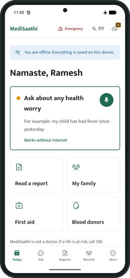
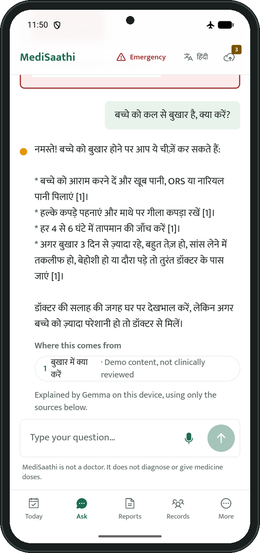
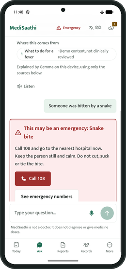
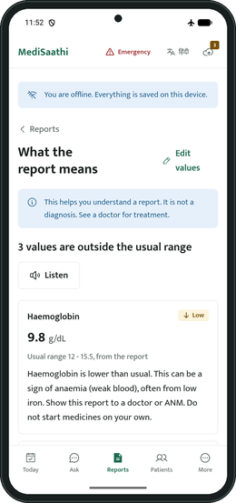
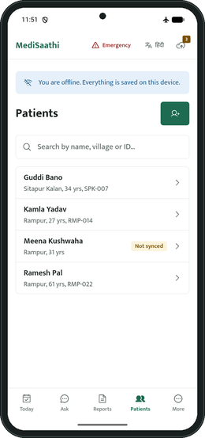
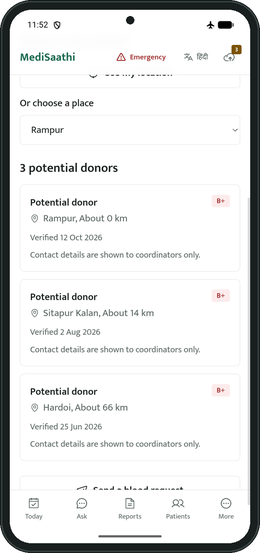

# MediSaathi

A personal health helper and community healthcare tool that works completely without internet. Ask health questions by typing or speaking, in Hindi, English, Hinglish or 11 more Indian languages, explain lab reports with on-device OCR, maintain family and patient health notes and follow-ups, access first-aid guidance, and find blood donors.

Single unified codebase built with **Vite + React Router + TailwindCSS**, supporting **Website (PWA)** and **Android (Capacitor)**. Answers come from a built-in library of first-aid and home-care guidance; an optional on-device Gemma model (Google LiteRT-LM) rephrases them in plain words. Nothing about your health leaves the device. Only peer-to-peer blood requests optionally use a backend server.

> All medical content in `content/` is demo content and **has not been clinically reviewed**. Donors are synthetic.

| Home | Ask in Hindi (Gemma 4 on the phone) | Emergency: AI skipped | Lab report explained | Patients | Blood donors |
|---|---|---|---|---|---|
|  |  |  |  |  |  |

*Real screenshots from the Android app on a Pixel 7 emulator in airplane mode.*

## What it does
- **Ask**: health questions by text or voice. Emergency rules run first (snake bite, not breathing: straight to Call 108, no model). Otherwise the answer comes from the guidance library, optionally reworded by Gemma 4 on the device, and always cites its source.
- **Hinglish and voice**: loose Roman spellings are understood (`bukhar` / `bukhaar`, `saanp` / `saamp`, `nahi` / `nahin`), and so are English words heard in Hindi (फीवर, स्नेक बाइट). Voice input runs on the device where the phone or browser can, so it works offline.
- **Family on one phone**: each family member signs in with their own account and PIN and switches in one tap; records stay separate.
- **13 languages**: the whole app in Hindi, English, Tamil, Telugu, Bengali, Marathi, Gujarati, Kannada, Malayalam, Punjabi, Odia, Assamese and Urdu.
- **MediScan**: photo or PDF of a lab report, read on the device; you check flagged values; each value is marked low, normal or high and explained in plain words, read aloud.
- **ASHA Assist**: patients, append-only visits and follow-ups, saved on the phone first and synced later.
- **BloodLink**: nearest potential donors of the same group, coarse locations only; a donor's number is shared only after they accept a request.
- **Guidance and emergency**: offline first-aid library and one-tap 108 / 102 / 112.
- **Hands-free Saathi**: one big button. Speak, hear the answer, speak again, with no reading or typing. In an emergency it says what to do, Call 108 and the nearest 24-hour hospital, then stops.
- **Medicine strip scan**: photo of a strip or box, read on the device; shows what the medicine is for, a warning, and whether it has expired. Brand names (Dolo, Crocin, Calpol) map to the generic.
- **Outbreak early warning**: ASHA visits record symptoms; when one village has 3 or more patients with the same symptom in 7 days and at least double the week before, workers see an alert and an offline village map.
- **Vaccines and pregnancy checkups**: the national schedule (UIP) from a child's date of birth, and ANC checkups and Td doses from the last period date, with the expected delivery date. Due items show on Today; doses are recorded offline and sync as visits.
- **Nearest health centre**: offline distance to the nearest PHC and the nearest 24-hour hospital, shown with answers, emergencies and Saathi.
- **SMS to donors**: coordinators text matching donors through the phone's own SMS app, one message per donor so no donor sees another's number (audited). Blood requests can be shared by SMS or WhatsApp.
- **ABHA / FHIR export**: a person's record (ABHA number, lab values, vaccines, visits) as an ABDM-style FHIR R4 bundle, shared or downloaded from the device. Linking to ABDM itself (HIP, consent manager) needs ABDM sandbox registration and is not built.
- **ABHA check with DigiLocker (demo)**: compares the name, gender and age we hold with DigiLocker's identity answer for the ABHA number, and names any field that does not match. In this build the answer comes from synthetic demo data (`content/demo_digilocker.json`) and nothing is sent; the screen says so. Real DigiLocker access needs a registered partner organisation.

## Try the demo
Two offline demo accounts, PIN **1234** for both: **Sunita Devi** (ASHA worker: patients, visits, sync) and **Ramesh Kumar** (citizen: reports, family, Ask). Switch under More. Turn on airplane mode to see that nothing needs the network.

## Layout
| Path | What |
|---|---|
| `frontend/` | Unified Vite + React Router application: website, PWA and Android app (Capacitor, `frontend/android/`) |
| `backend/` | FastAPI server for blood requests and worker sync API |
| `contracts/` | OpenAPI spec exported from the backend |
| `content/` | Bundled content: guidance library, emergency rules, lab tests, medicines, vaccine schedule, health centres, demo donors, patients and visits, places |
| `docs/` | PRD, TRD, design system, screenshots |

## Run the Frontend
```bash
cd frontend
npm install
npm run dev          # http://localhost:5173 (copies OCR and LiteRT runtimes into public/ automatically)
npm test             # unit tests (vitest: 36 files, 210 tests)
npx playwright test  # 34 end-to-end flows on phone and laptop sizes (68 tests)
npm run build        # production PWA build in dist/, with offline service worker
npm run preview      # preview production build locally
```
Everything runs directly in the browser: SQLite (OPFS/WASM) for records, Tesseract.js for reading reports, on-device guidance library, and LiteRT-LM.

### The On-Device Model (Optional)
Navigate to More / Settings → **Offline AI model**. Without a model, the assistant still answers reliably straight from the verified guidance library.
- **Gemma 4 E2B** (2.0 GB on web, 2.6 GB on Android): one tap download from Hugging Face.
- **Gemma 3n E2B** (3.0 GB / 3.7 GB): gated by Google's Gemma license. Accept on [Hugging Face](https://huggingface.co/google/gemma-3n-E2B-it-litert-lm), download the file (`gemma-3n-E2B-it-int4-Web.litertlm` for web, `gemma-3n-E2B-it-int4.litertlm` for Android), and select it in the app.
- **Web**: uses WebGPU in modern Chromium/Edge browsers. Runtime `@litert-lm/core` is pinned to **0.18.0**.
- **Android**: native LiteRT-LM (`litertlm-android` 0.18.0) using the GPU with CPU fallback.
- **Online (Gemini), optional prototype**: set `GEMINI_API_KEY` in `backend/.env` (model: `GEMINI_MODEL`, default `gemini-3.8-flash`), then choose **Online (Gemini)** under Offline AI model. The key stays on the server (`POST /api/v1/assist`, 30 calls per hour per address). The app sends only the question, its language and the ids of the matched library cards, and the server writes the prompt itself, never records or reports; without internet the app uses Gemma on the device or the library.
- **Safety**: emergencies are detected and answered by deterministic rules before any model runs; every model answer is verified against grounded sources (citations, values, medication names) and falls back to verified library text if discrepancies are detected.

### Voice Input and Hinglish
- **Android**: Android's own speech recogniser (`SpeechPlugin.kt`), on the device when the phone has it (Android 12+), otherwise the system recogniser asked to prefer offline. The microphone permission is asked only on the first tap.
- **Website**: the Web Speech API. When the browser has the language pack (Chrome or Edge), recognition runs on the device (`processLocally`) and works offline; otherwise the pack downloads in the background for next time, and the browser's online service answers meanwhile.
- If voice cannot work (no pack and no internet, microphone blocked), the chat says so and typing always works. Speaking adds to what was typed.
- **Hinglish**: `src/domain/hinglish.ts` folds common spelling variants (aa/a, ee/i, kh/k, nasal n, nukta, chandrabindu) to one key on both the question and the search index, so emergency rules, Ask and guidance search all match them. Add new words to the `keywords` in `content/guidance.json` or the rule terms in `content/emergency_rules.json`.

## Run the Backend (Blood Requests & Sync)
```bash
cd backend
python -m venv .venv
.venv/Scripts/pip install -r requirements.txt -r requirements-dev.txt   # macOS/Linux: .venv/bin/pip
cp .env.example .env        # set MEDISAATHI_SECRET; DEMO_PASSWORD is required to seed the demo accounts
.venv/Scripts/python -m uvicorn app.main:app --port 8000 --env-file .env
.venv/Scripts/python -m pytest   # 83 tests
```
- API documentation: http://localhost:8000/docs. The frontend calls `VITE_API_URL` (default `http://localhost:8000`).
- No user accounts required for blood requests. Each request and donor registration uses random local cryptographic tokens.
- Privacy-first: A donor's contact is only revealed after explicit in-app confirmation.
- Worker accounts: Argon2 passwords, 15-minute access tokens with rotating refresh tokens, login limits per account, user + address and address; sync is idempotent and scoped to the worker's assigned area. Admin panel (SQLAdmin) at `/admin`.

### Accounts: sign up and Google sign-in
- **Create account** on the sign-in screen makes a **citizen** account (`POST /api/v1/auth/signup`: name, username of 3 to 32 letters, numbers, `.` `_` `-`, password of at least 8 characters; 5 sign-ups per address per 15 minutes). ASHA worker and coordinator accounts carry a village scope, so an admin creates them at `/admin`.
- **Continue with Google** appears only when a client ID is set. On the website it is Google's own button; in the Android app it is the system account picker (Google blocks its sign-in page inside WebViews). The server checks the ID token with Google (audience, issuer, verified email, expiry) and creates a citizen account the first time.
- Setup in [Google Cloud Console](https://console.cloud.google.com/apis/credentials):
  1. OAuth consent screen: External, app name MediSaathi.
  2. Create an OAuth client of type **Web application**. Authorised JavaScript origins: `http://localhost:5173`, `http://localhost:4173` and your website's origin.
  3. Put its client ID in `backend/.env` as `GOOGLE_CLIENT_ID=` and in `frontend/.env.local` as `VITE_GOOGLE_CLIENT_ID=` (the same value), then rebuild the frontend.
  4. For Android, also create an OAuth client of type **Android**: package `in.medisaathi.app`, and the SHA-1 from `cd frontend/android && ./gradlew signingReport` (debug and release keys each need one). The app still sends the **Web** client ID; the Android client only tells Google that this signed app may ask.

## Build the Android App
Requires Android SDK and **JDK 17 or 21** (this Gradle version cannot run on JDK 25; set `JAVA_HOME` to a 17 or 21 JDK). `android/build.gradle` compiles every module, Capacitor's included, for Java 17.
```bash
cd frontend
npm run build
npx cap sync android
cd android
./gradlew assembleDebug   # -> app/build/outputs/apk/debug/app-debug.apk
```
- Native plugins in `frontend/android/app/src/main/java/in/medisaathi/app/`: `GemmaPlugin.kt` (LiteRT-LM) and `SpeechPlugin.kt` (voice input), both registered in `MainActivity.java`.
- File export uses the official `@capacitor/filesystem` and `@capacitor/share` plugins (share sheet on Android, download on the website).
- A ready-built debug APK is in `apk/MediSaathi.apk`.
- Follow-up reminders only display non-sensitive counts on the lock screen.
